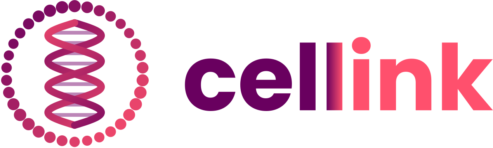
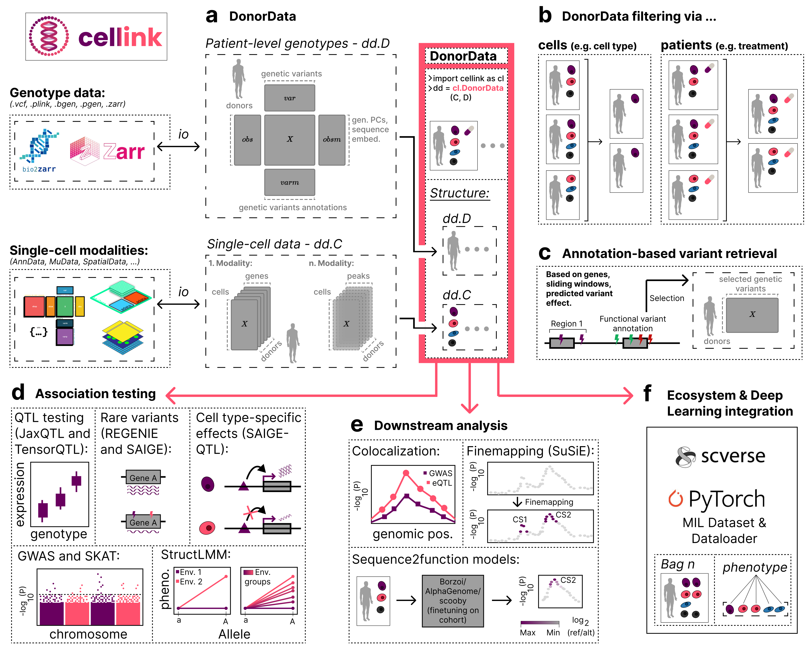

<!-- logo-image-start -->

<p align="center">
  
</p>

<br>

<!-- logo-image-end -->

[](https://github.com/theislab/cellink/actions/workflows/build.yaml)
[](https://opensource.org/licenses/Apache-2.0)
[](https://cellink-docs.readthedocs.io/)
[](https://github.com/theislab/cellink/actions/workflows/test.yaml)
[](https://github.com/pre-commit/pre-commit)

# cellink bridges donor genotypes and single-cell profiles for end-to-end single-cell genetics

cellink brings single-cell data together with the genomes of the donors the cells come from. It reads genotypes from
VCF, PLINK, BGEN and PGEN files, keeps them paired with the cells of the same donors through every selection, and
runs genetic analyses on both. Established tools such as PLINK, tensorQTL, SAIGE-QTL, LDSC and MAGMA run directly on
your data, and cellink takes care of the file formats and conventions each of them expects.

<!-- schematic-image-start -->



<!-- schematic-image-end -->

## Data

cellink works on [`DonorData`](https://donordata.readthedocs.io) objects, which link the cells of a cohort to their
donors. In cellink the donor level `dd.D` holds the genotypes, with one row per donor and one column per variant, and
`dd.C` holds the cells as an AnnData or MuData. Selecting donors, variants or cells keeps both levels aligned, so
genotypes and expression always describe the same people.

```python
import cellink as cl

genotypes = cl.io.read_plink("cohort")
dd = cl.DonorData(D=genotypes, C=adata, donor_id="individual")
dd = dd[..., dd.C.obs["cell_type"] == "CD4 T", :]
dd.write_dd("cohort.dd.zarr")
```

`DonorData` is imported from the [DonorData](https://github.com/theislab/donordata) package and is installed with cellink. The
[DonorData documentation](https://donordata.readthedocs.io) explains how these objects are built and stored, and
how to add a sample level or the
[electronic health records](https://donordata.readthedocs.io/en/latest/tutorials/ehr_cohort.html) of the donors.

## Analyses

**Association testing**
- [eQTL mapping on pseudobulk with jaxQTL or tensorQTL](https://cellink-docs.readthedocs.io/en/latest/tutorials/pseudobulk_eqtl_jaxqtl_tensorqtl.html)
- [eQTL mapping on single cells with SAIGE-QTL](https://cellink-docs.readthedocs.io/en/latest/tutorials/single_cell_eqtl_saigeqtl.html)
- [A simple pseudobulk eQTL mapping](https://cellink-docs.readthedocs.io/en/latest/tutorials/pseudobulk_eqtl.html)
- [Rare variant association tests](https://cellink-docs.readthedocs.io/en/latest/tutorials/burden_testing.html)
- [Clumping and pruning](https://cellink-docs.readthedocs.io/en/latest/tutorials/clumping_pruning.html)
- [Colocalization](https://cellink-docs.readthedocs.io/en/latest/tutorials/colocalization.html)
- [Writing association tests as formula strings](https://cellink-docs.readthedocs.io/en/latest/tutorials/formula_resolver.html)

**Heritability, gene programs and GWAS integration**
- [LD score regression for cell types](https://cellink-docs.readthedocs.io/en/latest/tutorials/cell_level_ldsc_analysis.html)
- [Gene program scoring with sc-linker](https://cellink-docs.readthedocs.io/en/latest/tutorials/sclinker.html)
- [Gene set enrichment with MAGMA](https://cellink-docs.readthedocs.io/en/latest/tutorials/magma_analysis_tutorial.html)
- [Disease relevance of single cells from GWAS with scDRS and seismic](https://cellink-docs.readthedocs.io/en/latest/tutorials/scdrs_seismic.html)
- [Cell neighborhoods associated with disease with scEPS](https://cellink-docs.readthedocs.io/en/latest/tutorials/sceps.html)
- [GWAS on spatial data with gsMap](https://cellink-docs.readthedocs.io/en/latest/tutorials/gsmap.html)

**Deep learning**
- [Learning donor representations with LIVI](https://cellink-docs.readthedocs.io/en/latest/tutorials/livi.html)
- [Predicting single cell coverage from sequence and scoring variants with scooby](https://cellink-docs.readthedocs.io/en/latest/tutorials/scooby.html)
- [Dataloaders for deep learning](https://cellink-docs.readthedocs.io/en/latest/tutorials/run_dataloader.html), including multiple instance learning over the cells of each donor

**Variants**
- [Quality control, annotation and selection of genetic variants](https://cellink-docs.readthedocs.io/en/latest/tutorials/explore_annotations.html)

## Getting started

cellink is not on PyPI yet and will be published there as `cellink-tools`. Install the development version from
GitHub, which also installs DonorData:

```bash
pip install git+https://github.com/theislab/cellink.git@main
```

The [installation guide](https://cellink-docs.readthedocs.io/en/latest/installation.html) lists the optional extras
for the external tools. If you are new to cellink, start with
[DonorData basics](https://cellink-docs.readthedocs.io/en/latest/tutorials/donordata_basics.html), which builds an
object from genotype and expression data, subsets it and saves it without running any analysis.

## Documentation

| | |
|---|---|
| [Installation guide](https://cellink-docs.readthedocs.io/en/latest/installation.html) | Requirements and the optional extras (`pip install cellink[extra-name]`) |
| [Tutorials](https://cellink-docs.readthedocs.io/en/latest/tutorials/index.html) | Step by step guides for the analyses above |
| [API reference](https://cellink-docs.readthedocs.io/en/latest/api/index.html) | Every public function and class, organized by module |
| [DonorData documentation](https://donordata.readthedocs.io) | The `DonorData` object, its sample level and its file format |
| [Contributing guide](https://cellink-docs.readthedocs.io/en/latest/contributing.html) | Development setup, tests and the pull request workflow |
| [Changelog](https://cellink-docs.readthedocs.io/en/latest/changelog.html) | What changed in each release |

## Contact

<!-- For questions and help requests, you can reach out in the [scverse discourse][]. -->

If you found a bug, please use the [issue tracker](https://github.com/theislab/cellink/issues).

## Release notes

t.b.a

<!-- See the [changelog][]. -->

## Citation

> t.b.a

[mambaforge]: https://github.com/conda-forge/miniforge#mambaforge
[scverse discourse]: https://discourse.scverse.org/
[issue tracker]: https://github.com/theislab/cellink/issues
